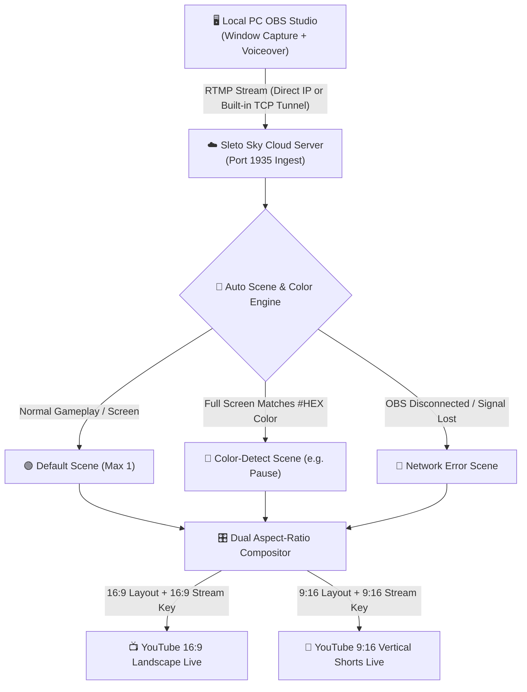

<div align="center">

# ☁️ free-live-24-7-by-sletoyt 🌸

### **Ultra-Lightweight Dual 16:9 & 9:16 Cloud OBS • Auto Color-Detect Scene Switcher • 24/7 Playout**

[](https://github.com/sletoyt/free-live-24-7-by-sletoyt)
[](#)
[](#)
[](LICENSE)

**Send your PC Window + Voiceover from OBS Studio once — `free-live-24-7-by-sletoyt` automatically switches scenes by screen color or signal status and streams to both `16:9 Landscape` and `9:16 Vertical Shorts` at the same time.**

</div>

---

## 🚀 1. VPS और Cloud में Add / Install करने की पूरी Process

आप इस टूल को किसी भी **Ubuntu / Debian VPS** या **GitHub Codespaces** पर कुछ ही सेकंड में चला सकते हैं।

### A. Ubuntu / Debian VPS पर चलाने की Process (Docker Compose)

अपने VPS टर्मिनल में लॉगिन करें और ये कमांड्स चलाएं:

```bash
git clone https://github.com/sletoyt/free-live-24-7-by-sletoyt.git
cd free-live-24-7-by-sletoyt
docker compose up -d --build
```

अब अपने ब्राउज़र में खोलें:
```text
http://YOUR_VPS_IP:3000
```

### B. Ubuntu / Debian VPS पर बिना Docker के Direct चलाने की Process

अगर आप बिना Docker के सीधा Node.js और FFmpeg के साथ चलाना चाहते हैं:

```bash
sudo apt-get update && sudo apt-get install -y nodejs npm ffmpeg openssh-client
git clone https://github.com/sletoyt/free-live-24-7-by-sletoyt.git
cd free-live-24-7-by-sletoyt
npm install
npm start
```

### C. GitHub Codespaces में चलाने की Process (Auto Port & Auto OBS Tunnel)

GitHub Codespaces के टर्मिनल में यह कमांड पेस्ट करें:

```bash
cd /workspaces/free-live-24-7-by-sletoyt
docker compose down 2>/dev/null || true
rm -rf free-live-24-7-by-sletoyt
git fetch origin main && git reset --hard origin/main
sudo apt-get update && sudo apt-get install -y ffmpeg openssh-client
npm install
npm start
```

- जैसे ही `npm start` चलेगा, टर्मिनल में आपको सीधा **`Codespaces Web UI`** का लिंक और **`Public OBS RTMP Server`** (`rtmp://...a.pinggy.link:PORT/live`) मिल जाएगा।

---

## ✨ 2. इसके सारे Features (All Features)

### 🌙 1. Dark Sky & Sakura Theme (Light Mode Toggle के साथ)
- डिफ़ॉल्ट रूप से यह आंखों को आराम देने वाले **Midnight Dark Sky & Sakura Theme** में खुलता है।
- ऊपर दिए गए **Light Sky / Dark Sky** बटन से आप कभी भी डार्क और लाइट मोड के बीच स्विच कर सकते हैं।

### 🔗 2. Built-in Automatic OBS RTMP Tunnel (`Failed to Connect` Fix)
- GitHub Codespaces या फ़ायरवॉल वाले सर्वर में पोर्ट `1935` ब्लॉक होने की वजह से OBS में `Failed to connect to server` आता था।
- अब यह टूल अपने आप एक **Public TCP Tunnel (`rtmp://...a.pinggy.link:PORT/live`)** बनाता है जो डैशबोर्ड पर सबसे ऊपर दिखता है। इसे कॉपी करके OBS में डालने पर OBS तुरंत कनेक्ट हो जाता है।

### ⚡ 3. Ultra-Lightweight Architecture (कम RAM और कम CPU खपत)
- सारे फीचर्स रखते हुए इसे बेहद हल्का (Lightweight) बनाया गया है:
  - FFmpeg में `ultrafast` और `zerolatency` प्रोफाइल का उपयोग।
  - बैकएंड कलर डिटेक्टर सिर्फ `8x8` पिक्सेल ग्रिड को `1 FPS` पर चेक करता है जिससे CPU लगभग `0%` खर्च होता है।
  - जब आप Studio टैब के बाहर होते हैं, तो ब्राउज़र कैनवास रेंडरिंग अपने आप थ्रॉटल हो जाती है।

### 🎬 4. Multi-Scene System (Live के दौरान भी Scene Add और Switch करें)
- आप एक ही लाइव चैनल में अनलिमिटेड सीन बना सकते हैं और लाइव चलते समय भी उन्हें 1-क्लिक में बदल सकते हैं।
- इसमें **3 प्रकार के विशेष सीन (Scene Types)** हैं:
  1. **🟢 Default Scene (अधिकतम 1):** जब आपकी लाइव चालू हो और स्क्रीन पर कोई ट्रिगर कलर न हो, तब यही मुख्य सीन चलता है।
  2. **🎨 Color-Detect Scene (Multiple):** इसमें आप कोई भी कलर कोड (जैसे `#000000` या `#38bdf8`) सेट कर सकते हैं। जब पूरी स्क्रीन पर वह रंग आता है, तो लाइव अपने आप इस सीन पर स्विच हो जाती है, और रंग हटते ही वापस **Default Scene** पर आ जाती है।
  3. **📡 Network Error Scene:** जब आपके PC के OBS से सिग्नल आना बंद हो जाता है, तो यह सीन अपने आप चालू हो जाता है और OBS दोबारा कनेक्ट होते ही वापस **Default Scene** पर आ जाता है।

### 📺📱 5. Simultaneous Dual 16:9 & 9:16 Live Playout (Side-by-Side Editor)
- **एक साथ 2 Live:** यह टूल एक ही समय पर **16:9 (YouTube Landscape)** और **9:16 (YouTube Shorts / Vertical)** दोनों स्ट्रीम कीज़ पर लाइव करता है।
- **Shared Sources, Independent Positions:** किसी भी सीन में जोड़ा गया सोर्स (Window Feed, Logo, Video, Text, BG Music) अपने आप `16:9` और `9:16` दोनों स्क्रीन में जुड़ जाता है।
- दोनों एडिट स्क्रीन (`16:9` और `9:16`) एक साथ अगल-बगल दिखती हैं ताकि आप एक ही सोर्स को `16:9` में अलग जगह और `9:16` में अलग जगह सेट कर सकें।
- जब सीन बदलता है, तो `16:9` और `9:16` दोनों में एक साथ सिंक होकर बदलता है।

### 📁 6. Built-in Cloud File System
- अपना **Background Music (`.mp3`, `.wav`)**, **Logos (`.png`, `.gif`)** और **Video Loops (`.mp4`, `.webm`)** सीधे टूल के फाइल सिस्टम में अपलोड करें।
- किसी भी फाइल को कभी भी वापस अपने डिवाइस में **Download** करें, नाम बदलें, या सीधे किसी भी सीन में इस्तेमाल करें।

### 📖 7. Beginner-Friendly UI & Step-by-Step Guide Tab
- नए यूज़र्स के लिए ऊपर नेविगेशन बार में **`📖 Guide (कैसे चलाएं)`** का अलग पेज दिया गया है जिसमें हर स्टेप आसान भाषा में समझाया गया है।

---

## ⚙️ 3. यह कैसे काम करता है (How It Works)



1. **Input (OBS से सिग्नल भेजना):**
   - आप अपने PC के OBS में सिर्फ अपनी गेम/विंडो स्क्रीन और माइक ऑन करते हैं।
   - डैशबोर्ड पर दिखने वाले **OBS Server URL** और **OBS Stream Key** (`live_sleto`) को अपने OBS (`Settings -> Stream -> Custom`) में डालकर **Start Streaming** दबाते हैं।
2. **Automatic Scene Detection (ऑटोमैटिक सीन बदलना):**
   - सर्वर हर सेकंड आपकी आने वाली स्क्रीन की जांच करता है।
   - अगर पूरी स्क्रीन पर वह रंग आ जाता है जो आपने किसी **Color-Detect Scene** (जैसे `Pause Scene`) में सेट किया है, तो सर्वर तुरंत दोनों लाइव (`16:9` और `9:16`) को उस सीन पर स्विच कर देता है।
   - जैसे ही स्क्रीन से वह रंग हटता है, सर्वर वापस **Default Scene** पर आ जाता है।
   - अगर आपके PC का इंटरनेट या OBS बंद हो जाता है, तो YouTube लाइव बंद नहीं होती — सर्वर तुरंत **Network Error Scene** चला देता है और OBS वापस जुड़ते ही **Default Scene** पर आ जाता है।
3. **Dual Output (16:9 + 9:16 एक साथ लाइव):**
   - प्रत्येक सीन के सभी सोर्स `16:9` कैनवास और `9:16` कैनवास के अलग-अलग कोऑर्डिनेट्स के अनुसार रेंडर होते हैं और दोनों अलग-अलग स्ट्रीम कीज़ पर एक साथ लाइव चलते रहते हैं।

---

## 🤝 4. Built Together by SletoYT & AI

इस प्रोजेक्ट (**`free-live-24-7-by-sletoyt`**) को **SletoYT** और **AI** ने मिलकर (in collaboration) डिज़ाइन और तैयार किया है।
इसका मुख्य विज़न, फीचर्स की प्लानिंग (जैसे ऑटो कलर-डिटेक्ट सीन स्विचिंग, नेटवर्क एरर सीन, और एक साथ `16:9` + `9:16` डुअल लाइव सिस्टम) **SletoYT** के आइडियाज़ पर आधारित हैं, जिसे हमने मिलकर एक सुपर-लाइटवेट और आसान क्लाउड स्ट्रीमिंग टूल का रूप दिया है।
