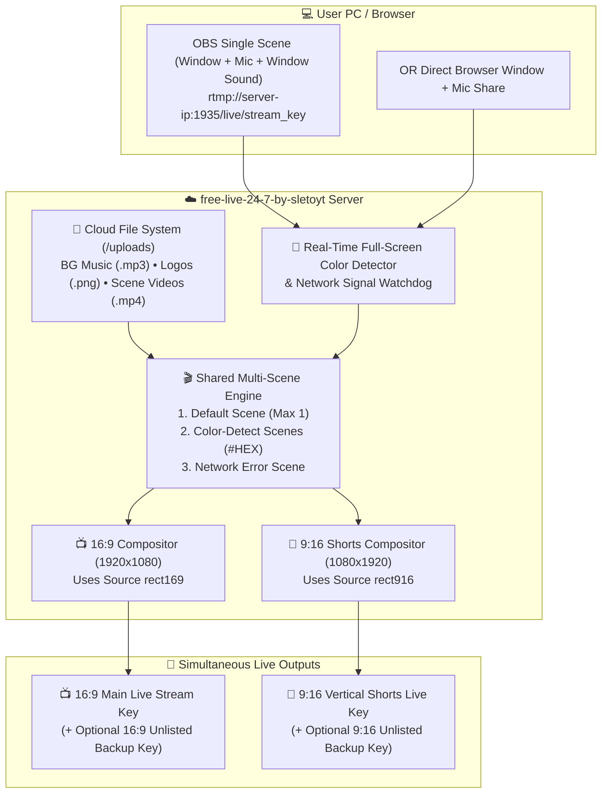
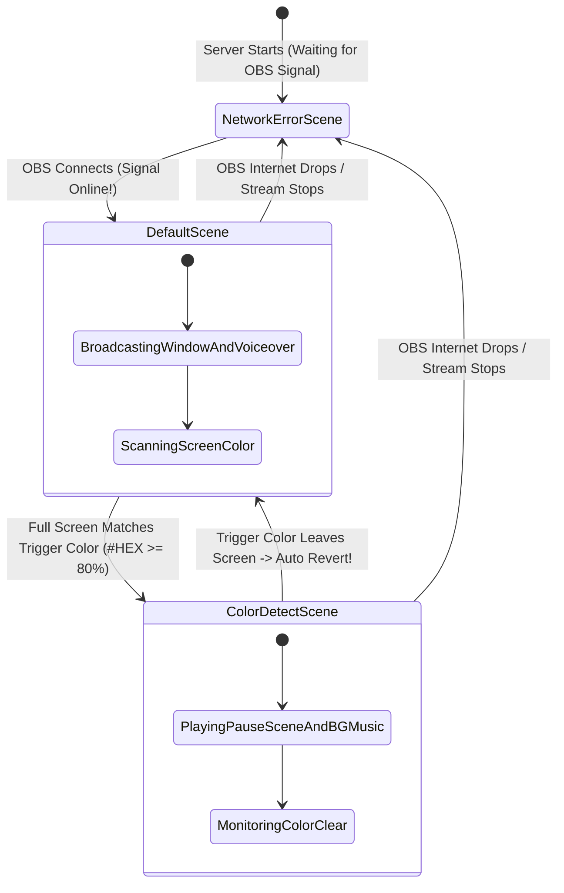

# ☁️🌸 free-live-24-7-by-sletoyt

> **Cute Sky-Themed 24/7 Dual Cloud Playout Server & Auto Color-Detect Web-OBS Studio**  
> *Simultaneous 16:9 + 9:16 Streaming • Full-Screen Color Auto Scene Switcher • Network Error Auto-Fallback • Built-In Cloud Media File System*

[](https://nodejs.org)
[](https://docker.com)
[](https://ffmpeg.org)
[](#)
[](LICENSE)

---

## 📑 Table of Contents

- [Overview](#-overview)
- [Visual Infographics & System Diagrams](#-visual-infographics--system-diagrams)
  - [1. End-to-End Dual 16:9 + 9:16 Pipeline](#1-end-to-end-dual-169--916-pipeline)
  - [2. Automatic 3-Type Scene Switcher State Machine](#2-automatic-3-type-scene-switcher-state-machine)
  - [3. Shared Scene Sources with Independent 16:9 & 9:16 Layouts](#3-shared-scene-sources-with-independent-169--916-layouts)
- [Core Features](#-core-features)
- [Project File Structure](#-project-file-structure)
- [Quick Start & Deployment](#-quick-start--deployment)
  - [Option A: Docker Compose (Recommended)](#option-a-docker-compose-recommended)
  - [Option B: Direct Node.js + FFmpeg](#option-b-direct-nodejs--ffmpeg)
- [Complete Step-by-Step Tutorials](#-complete-step-by-step-tutorials)
  - [Tutorial 1: Sending Window + Voiceover from Local OBS](#tutorial-1-sending-window--voiceover-from-local-obs)
  - [Tutorial 2: Uploading BG Music, Logos & Videos to the File System](#tutorial-2-uploading-bg-music-logos--videos-to-the-file-system)
  - [Tutorial 3: Setting Up the 3 Scene Types & Auto Color Detection](#tutorial-3-setting-up-the-3-scene-types--auto-color-detection)
  - [Tutorial 4: Side-by-Side Dual 16:9 & 9:16 Scene Editing](#tutorial-4-side-by-side-dual-169--916-scene-editing)
- [REST API Reference](#-rest-api-reference)
- [License](#-license)

---

## 🌸 Overview

**free-live-24-7-by-sletoyt** is a lightweight, cloud-native dual broadcast server and scene compositor built so you only have to send a single lightweight **Window + Voiceover** stream from your local PC OBS (or browser screen share) — and the cloud server handles everything else automatically:

1. **Simultaneous Dual Live Streaming (`16:9` + `9:16`)**: Broadcasts both your `1920x1080` Horizontal stream and `1080x1920` Vertical Shorts stream at the same time to separate RTMP stream keys!
2. **Automatic Full-Screen Color Detection Scene Switcher**: Detects when your incoming screen turns a specific solid color (e.g., OBS *Fade to Color* black `#000000`, green `#00ff00`, etc.) and automatically switches both `16:9` and `9:16` streams to the matching **Color-Detect Scene** (such as your cute Sky Pause scene with background music). As soon as that color leaves the screen, it automatically switches back to the **Default Scene**!
3. **Automatic Network Error Scene**: If your local PC internet drops or OBS disconnects, the tool immediately switches to the **Network Error Scene** so your live streams never go offline, and automatically switches back to the **Default Scene** when your live stream reconnects!
4. **Cloud File System**: Built-in media manager to upload, store, preview, and download your background music (`.mp3`, `.wav`), logos (`.png`, `.gif`), and scene video loops (`.mp4`, `.webm`).

---

## 📊 Visual Infographics & System Diagrams

### 1. End-to-End Dual 16:9 + 9:16 Pipeline



---

### 2. Automatic 3-Type Scene Switcher State Machine



---

### 3. Shared Scene Sources with Independent 16:9 & 9:16 Layouts

```
+-----------------------------------------------------------------------------+
|                    SHARED SCENE (e.g. "Pause Scene")                        |
|  Sources Added Once: [🎬 PAUSE_bg.mp4] + [🎵 PAUSE_music.mp3] + [🖼️ Logo]   |
+-----------------------------------------------------------------------------+
                     |                                     |
    Independent 16:9 Coordinates          Independent 9:16 Coordinates
            (rect169)                                 (rect916)
                     |                                     |
                     v                                     v
     +-------------------------------+             +---------------+
     |  16:9 LANDSCAPE (1920x1080)   |             | 9:16 VERTICAL |
     |  +-------------------------+  |             |  (1080x1920)  |
     |  |     PAUSE_bg.mp4        |  |             |  +---------+  |
     |  |         [Logo]          |  |             |  |  [Logo] |  |
     |  +-------------------------+  |             |  |PAUSE_bg |  |
     +-------------------------------+             |  +---------+  |
                     |                             +---------------+
                     v                                     |
        Streams to 16:9 RTMP Key                           v
                                              Streams to 9:16 Shorts Key
```

---

## ✨ Core Features

- **🌸 Cute Sky & Sakura Theme**: Pastel sky gradients, animated kawaii clouds, sakura petals, and bubbly rounded cards inspired by `sleto-stream-eliments`.
- **🎬 Multi-Scene System (Live & Offline Switching)**:
  - Add unlimited custom scenes per stream instance.
  - Switch scenes with 1 click while live — or let the **Auto Scene Switcher** handle everything automatically!
- **🎨 3 Specialized Scene Types**:
  1. **Default Scene (Maximum 1)**: Runs when your incoming OBS/Window feed is active and no trigger color fills the screen.
  2. **Color-Detect Scene (Multiple Allowed)**: Assign any hex color code (e.g. `#000000`, `#00ff00`, `#38bdf8`). When the entire incoming screen turns that color, the tool switches to this scene automatically, and returns to the Default Scene as soon as the color disappears.
  3. **Network Error Scene**: Automatically activates when no live stream is arriving from OBS, and automatically switches back to the Default Scene when OBS reconnects.
- **📺📱 Side-by-Side Dual 16:9 & 9:16 Studio Editor**:
  - Edit both the **16:9 Landscape** and **9:16 Vertical Shorts** screens side-by-side at the same time.
  - Sources added to a scene automatically appear in both `16:9` and `9:16`, while allowing you to position and resize each source independently for `16:9` and `9:16`.
  - When a scene changes, both `16:9` and `9:16` switch together in sync.
- **📁 Built-In Cloud File System**:
  - Upload background music (`.mp3`, `.wav`), logos (`.png`, `.gif`), and video loops (`.mp4`, `.webm`).
  - Download any stored file back to your device anytime, rename files, or pick them directly inside the Scene Studio.
- **📋 Real-Time Live Logs & System Health**:
  - Monitor scene switches, FFmpeg bitrates, RTMP connections, RAM usage, and server uptime in real time.

---

## 📁 Project File Structure

```text
free-live-24-7-by-sletoyt/
├── Dockerfile                   # Node.js 20 Alpine + FFmpeg container
├── docker-compose.yml           # Production Docker Compose configuration
├── package.json                 # Dependencies (express, multer, node-media-server, socket.io)
├── rtmp-config.js               # RTMP (1935) & HTTP-FLV (8000) server config
├── server.js                    # Dual playout engine, Color Detector, File System & API
├── README.md                    # Complete documentation & tutorials
├── LICENSE                      # MIT License
├── .gitignore                   # Git ignore rules
├── .dockerignore                # Docker ignore rules
└── public/
    ├── index.html               # Cute Sky UI, Dual Studio, File System & Live Logs
    ├── style.css                # Kawaii Sky & Sakura stylesheet + responsive dual monitors
    └── app.js                   # Dual canvas compositor, color sampler & audio mixer
```

---

## ⚡ Quick Start & Deployment

### Option A: Docker Compose (Recommended)

```bash
git clone https://github.com/sletoyt/free-live-24-7-by-sletoyt.git
cd free-live-24-7-by-sletoyt
docker compose up -d --build
```

Open your browser at: `http://YOUR_SERVER_IP:3000`

### Option B: Direct Node.js + FFmpeg

```bash
# Install Node.js & FFmpeg on Ubuntu/Debian
sudo apt update && sudo apt install -y nodejs npm ffmpeg

# Install dependencies & start server
npm install
npm start
```

---

## 📖 Complete Step-by-Step Tutorials

### Tutorial 1: Sending Window + Voiceover from Local OBS

1. In your local PC **OBS Studio**, create a single lightweight scene (e.g. `mai ye vha bhejuga`) containing:
   - **Window Capture / Game Capture** (`WINDOW`)
   - **Mic/Aux** (`mic`)
   - **Desktop Audio** (`window sound`)
2. Open the **free-live-24-7-by-sletoyt** web dashboard (`http://YOUR_SERVER_IP:3000`).
3. Copy the **Server URL** (`rtmp://YOUR_SERVER_IP:1935/live`) and **Stream Key** from your instance card.
4. Paste them into OBS under `Settings` ➔ `Stream` ➔ `Custom...` and click **Start Streaming**.

---

### Tutorial 2: Uploading BG Music, Logos & Videos to the File System

1. Click the **📁 File System (Music & Logos)** tab in the top navigation bar.
2. Drag and drop your background music (`.mp3`, `.wav`), channel logos (`.png`), and pause/starting video loops (`.mp4`) into the upload box.
3. Your files are permanently saved in the server's Cloud File System (`/uploads`). You can preview them, **Download** them anytime with the `⬇ Download` button, or add them to any scene in 1 click!

---

### Tutorial 3: Setting Up the 3 Scene Types & Auto Color Detection

1. Click **🎨 Dual 16:9 & 9:16 Scene Studio** on your stream card.
2. In the left **🎬 SCENES** panel, you have the 3 scene types:
   - **🟢 1. Default Scene (Max 1)**: Add your `+ 🖥️ Window + Voiceover` source here so your game/window plays whenever no trigger color is detected.
   - **🎨 2. Color-Detect Scene**: Select or create a Pause/Starting scene, set its type to **Color-Detect Scene**, and choose a **Trigger Color** (for example `#000000` if your OBS transitions with *Fade to Black*, or click **🎯 Grab Current Screen Color**). Add your Pause video and BG music from the File System!
   - **📡 3. Network Error Scene**: Add your standby video/banner here. Whenever OBS disconnects, the server automatically switches to this scene and returns to the Default Scene as soon as OBS reconnects.

---

### Tutorial 4: Side-by-Side Dual 16:9 & 9:16 Scene Editing

1. Inside the Studio, both the **📺 16:9 Landscape Monitor** and **📱 9:16 Vertical Shorts Monitor** are displayed side-by-side at the same time.
2. When you add a source (like a video loop, logo, or text) to a scene, it appears in **both** `16:9` and `9:16` automatically.
3. Drag and resize the source on the **16:9 Canvas** to set its horizontal layout, and drag/resize it on the **9:16 Canvas** to set its vertical Shorts layout independently!
4. Click **💾 Save All Scenes**, configure your **16:9 Stream Key** and **9:16 Shorts Stream Key**, and click **🚀 START DUAL LIVE (16:9 + 9:16 SIMULTANEOUS)**!

---

## 🔌 REST API Reference

| Method | Endpoint | Description |
| :--- | :--- | :--- |
| `GET` | `/api/instances` | List all dual playout instances |
| `POST` | `/api/instances` | Create a new dual playout instance |
| `PUT` | `/api/instances/:id/scenes` | Save scenes & independent `16:9` / `9:16` source coordinates |
| `POST` | `/api/instances/:id/switch-scene` | Switch active scene on both `16:9` and `9:16` |
| `POST` | `/api/instances/:id/start` | Start autonomous dual `16:9` + `9:16` playout |
| `POST` | `/api/instances/:id/start-dual-canvas` | Start studio dual live pipe (`16:9` + `9:16`) |
| `POST` | `/api/instances/:id/stop` | Stop dual broadcast |
| `GET` | `/api/files` | List all uploaded files in Cloud File System |
| `POST` | `/api/files/upload` | Upload BG music, logos, or videos |
| `GET` | `/api/files/download/:filename` | Download a file from Cloud File System |
| `DELETE` | `/api/files/:filename` | Delete a file from Cloud File System |
| `GET` | `/api/logs` | Fetch real-time server & scene switch logs |
| `GET` | `/api/system/status` | Fetch server CPU, RAM, and active streams status |

---

## 📄 License

- **Repository**: `free-live-24-7-by-sletoyt`
- **Author**: [sletoyt](https://github.com/sletoyt)
- **License**: [MIT License](LICENSE)
