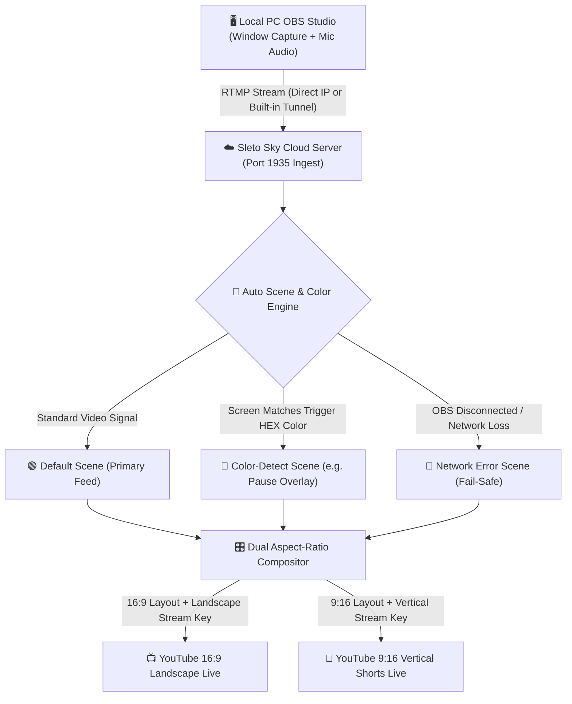

<div align="center">

# ☁️ free-live-24-7-by-sletoyt 🌸

### **Ultra-Lightweight Dual 16:9 & 9:16 Cloud OBS • Auto Color-Detect Scene Switcher • 24/7 Playout**

[](https://github.com/sletoyt/free-live-24-7-by-sletoyt)
[](#)
[](#)
[](LICENSE)

**Send your PC Window feed and voiceover from OBS Studio once — `free-live-24-7-by-sletoyt` handles the rest! It automatically triggers smart scene transitions based on screen color or connection health and broadcasts to both `16:9 Landscape` and `9:16 Vertical Shorts` simultaneously.**

---

### 🌟 Key Highlights at a Glance
| Feature | Description |
| :--- | :--- |
| **Simultaneous Dual Broadcast** | Stream to YouTube Landscape (`16:9`) and YouTube Shorts (`9:16`) at the same time. |
| **Smart Color Switcher** | Auto-switches scenes when a specific screen color is detected (e.g., pause screens). |
| **Network Fail-Safe** | Auto-displays an error scene if your PC disconnects, keeping the 24/7 stream alive. |
| **Zero-Config OBS Tunnel** | Built-in TCP tunneling solves firewall and port-forwarding issues out of the box. |
| **Ultra-Low Resource Usage**| Optimized pipeline consuming minimal CPU and RAM on VPS / Cloud instances. |

</div>

---

## 🚀 1. Installation & Cloud Setup Guide

You can deploy and run this tool within minutes on any **Ubuntu / Debian VPS** or directly inside **GitHub Codespaces**.


---

### Method A: Ubuntu / Debian VPS via Docker Compose (Recommended)

Log in to your VPS terminal and run:

```bash
git clone https://github.com/sletoyt/free-live-24-7-by-sletoyt.git
cd free-live-24-7-by-sletoyt
docker compose up -d --build
```

Access the Web Control Panel in your browser:
```text
http://YOUR_VPS_IP:3000
```

---

### Method B: Ubuntu / Debian VPS Direct Installation (Without Docker)

If you prefer running directly with Node.js and FFmpeg without containerization:

```bash
# 1. Update packages and install dependencies
sudo apt-get update && sudo apt-get install -y nodejs npm ffmpeg openssh-client

# 2. Clone the repository
git clone https://github.com/sletoyt/free-live-24-7-by-sletoyt.git
cd free-live-24-7-by-sletoyt

# 3. Install packages and start the engine
npm install
npm start
```

Open `http://YOUR_VPS_IP:3000` in your web browser.

---

### Method C: GitHub Codespaces (Auto Port Forwarding & OBS Tunnel)

Paste the following command directly into the GitHub Codespaces terminal:

```bash
cd /workspaces/free-live-24-7-by-sletoyt
docker compose down 2>/dev/null || true
rm -rf free-live-24-7-by-sletoyt
git fetch origin main && git reset --hard origin/main
sudo apt-get update && sudo apt-get install -y ffmpeg openssh-client
npm install
npm start
```

> **Note:** Once `npm start` executes, your terminal will display the **`Codespaces Web UI URL`** along with a ready-to-use **`Public OBS RTMP Server Link`** (`rtmp://...a.pinggy.link:PORT/live`).

---

## ✨ 2. Key Features

### 🌙 1. Dark Sky & Sakura Theme (with Light Mode Toggle)
- Features a clean, eye-friendly **Midnight Dark Sky & Sakura Theme** out of the box.
- Seamlessly toggle between dark and light modes using the top navigation bar switch.

### 🔗 2. Built-in Automatic OBS RTMP Tunnel (Fixes `Failed to Connect`)
- Cloud platforms (like GitHub Codespaces or restricted VPS setups) often block port `1935`, causing OBS to throw `Failed to connect to server`.
- An automatic **Public TCP Tunnel (`rtmp://...a.pinggy.link:PORT/live`)** is created and displayed directly on the dashboard. Copy this address into OBS to connect immediately without port forwarding.

### ⚡ 3. Ultra-Lightweight Architecture (Low CPU & RAM Footprint)
- Engineered for budget-friendly cloud instances:
  - **FFmpeg Engine:** Configured with `ultrafast` and `zerolatency` profiles.
  - **Color Detector:** Checks an ultra-efficient `8x8` pixel grid at `1 FPS`, resulting in nearly `0%` CPU utilization.
  - **Browser Optimization:** Throttles canvas rendering automatically whenever you navigate away from the Studio tab.

### 🎬 4. Dynamic Multi-Scene Engine
Create unlimited scenes and switch between them on the fly while streaming live.

```
                          ┌───► 🟢 Default Scene (Active gameplay / main feed)
                          │
Incoming Video Stream ────┼───► 🎨 Color-Detect Scene (Matches HEX code -> Pause/Overlay)
                          │
                          └───► 📡 Network Error Scene (Triggered if OBS drops signal)
```

1. **🟢 Default Scene (Max 1):** Your primary active live scene when no trigger colors are present.
2. **🎨 Color-Detect Scene (Multiple):** Set any HEX color code (e.g., `#000000` or `#38bdf8`). When your screen matches that color, the live broadcast automatically transitions to this scene. Once the color clears, it returns to the Default Scene.
3. **📡 Network Error Scene:** If your local OBS crashes or loses internet connection, this scene takes over immediately to keep your YouTube stream alive. Once OBS reconnects, it smoothly returns to your Default Scene.

### 📺📱 5. Dual 16:9 & 9:16 Playout (Side-by-Side Canvas Editor)
- **Two Simultaneous Streams:** Pushes video to both **16:9 (Landscape YouTube)** and **9:16 (Vertical YouTube Shorts)** stream keys simultaneously.
- **Shared Sources, Independent Layouts:** Add a source (Window Capture, Logo, Video Clip, Text, BGM) once, and it appears on both canvases. Position, scale, and adjust it independently for horizontal and vertical layouts.
- **Synchronized Transitions:** Any scene switch happens synchronously across both aspect ratios.

```
+---------------------------------------+   +-------------------+
|            16:9 Landscape             |   |   9:16 Vertical   |
|                                       |   |                   |
|   [ Game Feed / Window Capture ]      |   |   [ Camera Feed ] |
|                                       |   |                   |
|                                       |   |   [ Game Feed ]   |
|   [ Overlay / BGM ]    [ Logo ]       |   |   [ Chat / Logo ] |
+---------------------------------------+   +-------------------+
```

### 📁 6. Built-in Cloud Asset Manager
- Upload and manage your **Background Music (`.mp3`, `.wav`)**, **Brand Logos (`.png`, `.gif`)**, and **Video Loops (`.mp4`, `.webm`)** right from the cloud dashboard.
- Download, rename, delete, or link files into your scenes with one click.

### 📖 7. Beginner-Friendly Onboarding
- Includes an integrated **`📖 Guide`** tab with step-by-step instructions designed to help first-time streamers get up and running without technical roadblocks.

---

## ⚙️ 3. How It Works (Architecture Pipeline)



### Step-by-Step Workflow:

1. **Input (Sending Feed from Local OBS):**
   - Open OBS Studio on your local PC. Add your game/window capture and microphone.
   - Go to `Settings -> Stream -> Service: Custom`.
   - Paste the **OBS Server URL** and **Stream Key** (`live_sleto`) shown on your cloud dashboard, then click **Start Streaming**.

2. **Automated Scene Switching:**
   - The cloud engine continuously samples the incoming stream.
   - If the screen color matches a configured HEX value (e.g., a menu or pause screen), both streams shift to your designated **Color-Detect Scene**.
   - When normal gameplay resumes, the stream seamlessly reverts to the **Default Scene**.
   - If your home connection drops, the **Network Error Scene** activates immediately, ensuring your YouTube stream does not terminate.

3. **Dual Live Broadcast Output:**
   - All sources are rendered independently onto `16:9` and `9:16` target frames and streamed to their respective endpoints concurrently.

---

## 🤝 4. Credits & Collaboration

This project (**`free-live-24-7-by-sletoyt`**) was envisioned, designed, and developed collaboratively by **SletoYT** and **AI**.

The core ideas—including automatic color-detect scene transitions, automatic network error fail-safes, and simultaneous dual 16:9 + 9:16 cloud streaming—were conceptualized by **SletoYT** to create a lightweight, robust, 24/7 cloud streaming solution.
